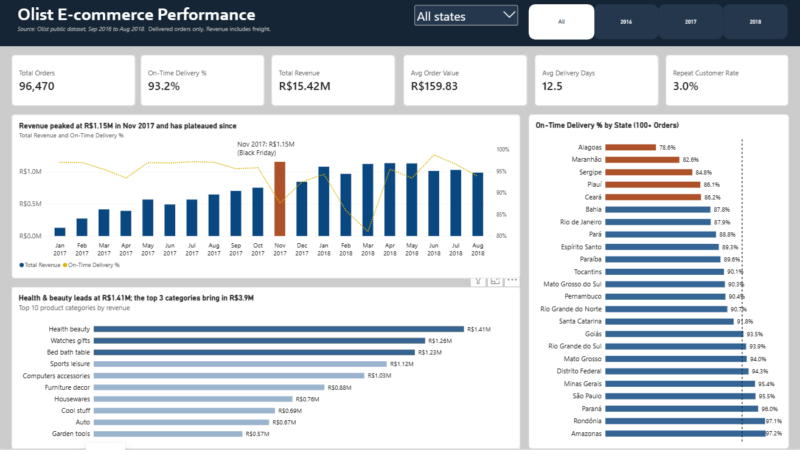
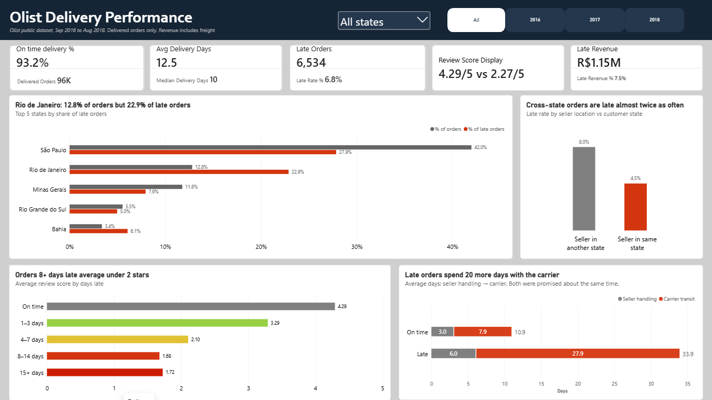
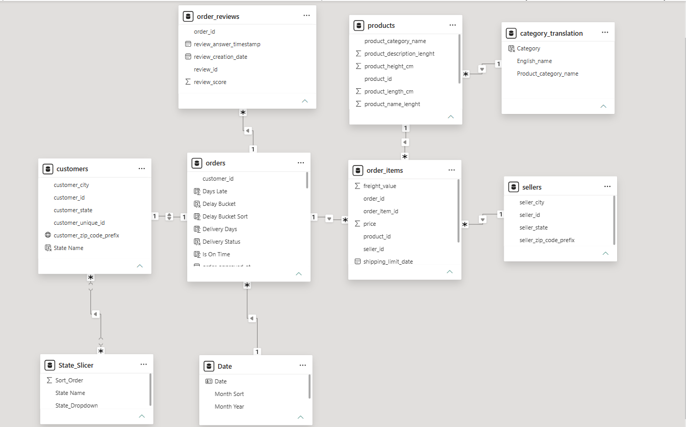

# Power BI Dashboard: Model, Measures and QA

File: [`Olist main.pbix`](Olist%20main.pbix). It imports from SQL Server (`localhost\SQLEXPRESS01`, database `Olist_Retail_DB`), and all 7 source tables come from the database, so one refresh updates the whole report.

## 1. Pages

### Overview: how big is the business, and is it growing?



| Visual | What it shows |
| --- | --- |
| KPI cards | Total Orders 96,470 · On-Time Delivery 93.2% · Total Revenue R$15.42M · Avg Order Value R$159.83 · Avg Delivery Days 12.5 · Repeat Customer Rate 3.0% |
| Revenue and on-time rate by month (combo) | **"Revenue peaked at R$1.15M in Nov 2017 and has plateaued since."** Nov 2017 (Black Friday) is highlighted and annotated. The on-time line drops in the same month and again in Feb–Mar 2018 |
| On-time % by state | Every state with 100+ orders. The five lowest are highlighted, and the dashed line is the national rate (93.2%) |
| Top 10 categories by revenue | **"Health & beauty leads at R$1.41M; the top 3 categories bring in R$3.9M."** The top 3 bars are highlighted |

### Delivery: why are orders late, and what does it cost?



| Visual | What it shows |
| --- | --- |
| KPI cards | On-time 93.2% (96K delivered orders) · Avg Delivery Days 12.5 (median 10) · Late Orders 6,534 (6.8%) · Review score on time vs late 4.29/5 vs 2.27/5 · Late Revenue R$1.15M (7.5%) |
| Share of orders vs share of late orders, top 5 states | **"Rio de Janeiro: 12.8% of orders but 22.9% of late orders."** |
| Late rate by route | **"Cross-state orders are late almost twice as often"**: 8.0% when the seller is in another state, vs 4.5% in the same state |
| Avg review by days late | **"Orders 8+ days late average under 2 stars"**: 4.29 on time, 3.29 at 1–3 days, 2.10 at 4–7, 1.68 at 8–14 and 1.72 at 15+ |
| Days per stage, on time vs late (stacked) | **"Late orders spend 20 more days with the carrier"**: 3.0 + 7.9 = 10.9 days on time, vs 6.0 + 27.9 = 33.9 days late. The tooltip shows the promised window (24.5 vs 23.3 days) |

Both pages have a State dropdown (with an "All states" option), Year buttons and a Clear-slicers button.

**Design choices**
- Every chart title states the finding, not the field names, so a reader gets the point without studying the axes.
- Red and orange always mean late or bad. Grey and blue are neutral.
- A report-level filter keeps only delivered orders that have a delivery date (see section 6), so every card uses the same scope as the SQL.

## 2. Data model



This is a star schema with `orders` at the centre. `order_items` and `order_reviews` are the detail tables; customers, products, sellers and dates describe them.

| From | To | Cardinality | Filter direction |
| --- | --- | --- | --- |
| order_items[order_id] | orders[order_id] | many-to-one | single |
| order_reviews[order_id] | orders[order_id] | many-to-one | single |
| orders[customer_id] | customers[customer_id] | one-to-one | both |
| order_items[product_id] | products[product_id] | many-to-one | single |
| order_items[seller_id] | sellers[seller_id] | many-to-one | single |
| products[product_category_name] | category_translation[Product_category_name] | many-to-one | single |
| orders[Purchase Date] | Date[Date] | many-to-one | single |
| State_Slicer[State Name] | customers[State Name] | many-to-many | single (slicer filters customers) |

`order_payments` is in the database but not in the model, because revenue is defined as price + freight from `order_items` (see the [charter](../docs/01_project_charter.md#6-assumptions)).

## 3. Calculated tables and columns

| Name | Table | Logic |
| --- | --- | --- |
| Date | (table) | `CALENDAR(2016-01-01, 2018-08-31)` plus Year, Month Year and Month Sort |
| State_Slicer | (table) | Every state listed twice, once under "All states" and once under its own name, so the dropdown has an "All states" option |
| Purchase Date | orders | Purchase timestamp without the time; joins to Date |
| Delivery Days | orders | `DATEDIFF(purchase, delivered, DAY)` |
| Is On Time | orders | 1 if `TRUNC(delivered) <= TRUNC(estimated)`, else 0 (compared by calendar day, as in SQL) |
| Delivery Status | orders | "On time" / "Late" |
| Days Late | orders | Days after the estimate, minimum 1, for late orders only |
| Delay Bucket, Delay Bucket Sort | orders | On time / 1–3 / 4–7 / 8–14 / 15+ days, with a sort key |
| Route | orders | "Seller in another state" if any item in the order ships from a seller outside the customer's state, else "Seller in same state" |
| State Name | customers | State code to full name (SP → São Paulo) |
| Category | category_translation | English name with underscores removed and the first letter capitalised |

```dax
Route =
VAR CustState = RELATED ( customers[customer_state] )
VAR CrossItems =
    COUNTROWS (
        FILTER ( RELATEDTABLE ( order_items ),
            RELATED ( sellers[seller_state] ) <> CustState ) )
RETURN IF ( CrossItems > 0, "Seller in another state", "Seller in same state" )
```

## 4. Measures

32 measures, grouped by the question they answer.

| Group | Measures |
| --- | --- |
| Volume and revenue | Total Orders · Delivered Orders · Total Revenue · Delivered Revenue · Avg Order Value |
| Delivery | On-Time Delivery % · Late Orders · Late Rate % · Avg Delivery Days · Median Delivery Days |
| Why late | Avg Seller To Carrier Days · Avg Carrier To Customer Days · Avg Promised Days |
| Cost of lateness | Late Revenue · Late Revenue % · Share of Orders · Share of Late Orders |
| Reviews | Avg Review Score · Avg Review (On Time) · Avg Review (Late) |
| Customers | Customers · Repeat Customer Rate |
| Time intelligence | Revenue PY · Orders PY · Revenue YoY % (shown only when one year is selected and the prior year has 500+ orders, so 2016 isn't compared with nothing) |
| Status | Cancel Rate (canceled + unavailable ÷ all orders) |
| Display helpers | Review Score Display · Review Compare · On time score · Late score · Review Score Display star · Carrier Color |

Key definitions:

```dax
On-Time Delivery % = AVERAGE ( orders[Is On Time] )

Late Orders = COUNT ( orders[Is On Time] ) - SUM ( orders[Is On Time] )

Late Revenue =
CALCULATE ( SUMX ( order_items, order_items[price] + order_items[freight_value] ),
    orders[order_status] = "delivered", orders[Days Late] > 0 )

Share of Orders =
DIVIDE ( [Delivered Orders],
    CALCULATE ( [Delivered Orders], REMOVEFILTERS ( customers ), REMOVEFILTERS ( State_Slicer ) ) )

Share of Late Orders =
DIVIDE ( [Late Orders],
    CALCULATE ( [Late Orders], REMOVEFILTERS ( customers ), REMOVEFILTERS ( State_Slicer ) ) )

Avg Carrier To Customer Days =
AVERAGEX (
    FILTER ( orders, orders[order_status] = "delivered"
        && NOT ISBLANK ( orders[order_delivered_carrier_date] )
        && NOT ISBLANK ( orders[order_delivered_customer_date] ) ),
    DATEDIFF ( orders[order_delivered_carrier_date], orders[order_delivered_customer_date], DAY ) )

Repeat Customer Rate =
DIVIDE (
    COUNTROWS ( FILTER ( VALUES ( customers[customer_unique_id] ), [Total Orders] > 1 ) ),
    [Customers] )
```

`Share of Orders` uses `Delivered Orders` in both the numerator and the denominator. An earlier version counted every order in the denominator, which made Rio de Janeiro look like 12.4% of orders instead of 12.8%. The SQL reconciliation caught it.

## 5. QA: dashboard vs SQL

Each value was checked with no slicers selected, against the matching query in [`sql/05_analysis.sql`](../sql/05_analysis.sql) ([results](../sql/05_results.md)).

| Measure | Dashboard | SQL | Match |
| --- | --- | --- | --- |
| Total Orders | 96,470 | 96,470 delivered with a date (Query 4); 96,478 in total (Query 3) | Yes; the 8 dateless orders are DQ-03 |
| Total Revenue | R$15,418,394.83 | R$15,418,394.83 (Query 14) | Yes |
| Avg Order Value | R$159.83 | R$159.83 (Query 3) | Yes |
| On-Time Delivery % | 93.2% | 93.23% (Query 4) | Yes |
| Late Orders / Late Rate % | 6,534 / 6.8% | 6,534 / 6.77% (Query 9) | Yes |
| Avg / Median Delivery Days | 12.5 / 10 | 12.5 / 10 (Query 4) | Yes |
| Late Revenue / Late Revenue % | R$1.15M / 7.5% | R$1,150,892.13 / 7.46% (Query 14) | Yes |
| Repeat Customer Rate | 3.0% | 3.00% (Query 5) | Yes |
| Avg review, on time vs late | 4.29 vs 2.27 | 4.29 vs 2.27 (Query 8) | Yes (RC-03) |
| Seller → carrier / carrier → customer days | 3.0 / 7.9 on time, 6.0 / 27.9 late | Same (Query 13) | Yes |
| RJ share of orders / of late orders | 12.8% / 22.9% | 12.8% / 22.9% (Query 9) | Yes |
| Late rate, cross-state vs same state | 8.0% / 4.5% | 8.0% / 4.5% (Query 12) | Yes |
| Revenue peak, Nov 2017 | R$1.15M | R$1,153,364.20 (Query 7) | Yes |
| Health & beauty revenue | R$1.41M | R$1,412,089.53 (Query 6) | Yes |

Every difference between the two, and the decision taken, is logged in the [issue log](../docs/04_issue_log.md#dashboard-reconciliation) (RC-01 to RC-06).

## 6. Report filters

Applied to all pages:
- `orders[order_status]` = delivered
- `orders[order_delivered_customer_date]` is not blank

Both filters are needed. Without the status filter, 6 canceled orders that have a delivery date would be counted. Without the date filter, `Is On Time` would count the 8 delivered orders with no delivery date as on time.
