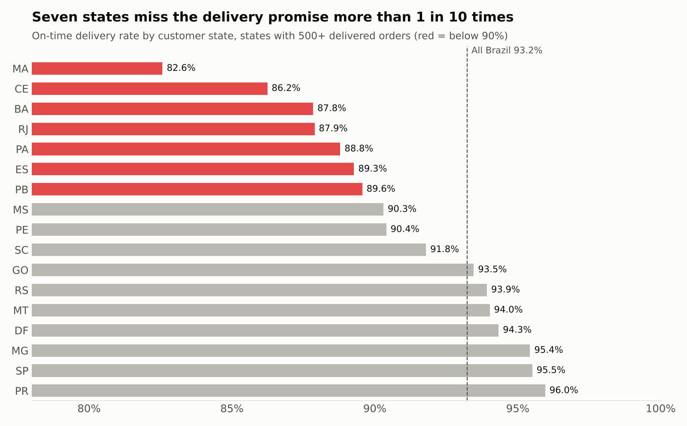
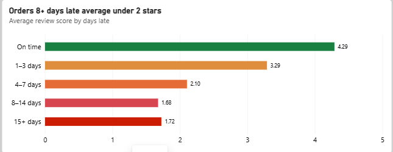
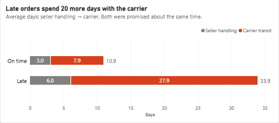
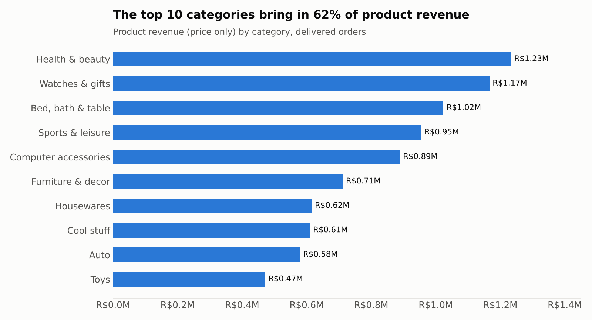

# Analysis Results

Results of [`05_analysis.sql`](05_analysis.sql) on the full dataset, each with a one-line takeaway. All money is in Brazilian reais (R$). Scope: delivered orders, purchased Sep 2016 – Aug 2018.

**Validation:** every number below was cross-checked by an independent Python re-implementation of the query on the raw CSVs, and matches the "Expected" comment under that query. The Power BI cards were then reconciled against these results ([Power BI QA](../powerbi/README.md#5-qa-dashboard-vs-sql)); the few differences are explained in the [issue log](../docs/04_issue_log.md#dashboard-reconciliation).

## Headline KPIs

| KPI | Value | Query |
| --- | --- | --- |
| Delivered orders | 96,478 | 3 |
| Items sold | 110,197 | 3 |
| Total revenue | R$15,419,773.75 | 3 |
| Product revenue | R$13,221,498.11 (86%) | 3 |
| Shipping revenue | R$2,198,275.64 (14%) | 3 |
| Average order value | R$159.83 | 3 |
| Avg delivery time | 12.5 days (median 10) | 4 |
| On-time rate | 93.23% | 4 |
| Repeat-customer rate | 3.00% (2,801 of 93,358) | 5 |

## Q1 & Q2: Revenue and trend (Queries 3, 7)

| Period | Monthly revenue |
| --- | --- |
| Jan 2017 | R$127,482 |
| Nov 2017 (peak, Black Friday) | R$1,153,364 |
| Dec 2017 | R$843,078 |
| Jan–Aug 2018 average | about R$1.06M |

**Takeaway:** revenue grew about 6.6x from Jan to Dec 2017, then flattened at roughly R$1M a month through 2018. Growth has stalled, which makes keeping existing customers more important.

## Q3: Delivery by state (Queries 4, 9)

| State | Delivered orders | Avg delivery days | On-time % | Share of orders | Share of late orders |
| --- | --- | --- | --- | --- | --- |
| MA | 717 | 21.5 | 82.57% | 0.7% | 1.9% |
| CE | 1,279 | 21.2 | 86.24% | 1.3% | 2.7% |
| BA | 3,256 | 19.3 | 87.84% | 3.4% | 6.1% |
| RJ | 12,350 | 15.2 | 87.89% | 12.8% | 22.9% |
| PA | 946 | 23.7 | 88.79% | 1.0% | 1.6% |
| SP (largest market) | 40,494 | 8.7 | 95.51% | 42.0% | 27.9% |

States with 500+ orders only. Smaller states such as AL (78.6%, 397 orders) are excluded to avoid ranking on tiny samples.

The dashboard's state chart uses a lower cut-off (100+ orders) so every state a manager might ask about is visible. At that cut-off, 10 states are below 90% on time (the seven named in the takeaway below, plus AL, SE and PI), with 23.1% of orders and 42.4% of late orders. The findings use the stricter 500+ cut-off (RC-06).

**Takeaway:** seven states (MA, CE, BA, RJ, PA, ES, PB) are below 90% on time. Together they place 21.8% of orders but receive 39.3% of late orders. Rio de Janeiro matters most: it is the second-largest market and alone accounts for 22.9% of all late orders.

## Q4: Late delivery vs review score (Queries 8, 10, 11)

| Delivery outcome | Orders | Avg review | Orders rated 2 stars or less |
| --- | --- | --- | --- |
| On time | 89,443 | 4.29 | 9.2% |
| 1–3 days late | 1,852 | 3.29 | 32.2% |
| 4–7 days late | 1,748 | 2.11 | 67.6% |
| 8+ days late | 2,781 | 1.70 | 79.2% |

The chart splits the 8+ bucket into 8–14 days (1.68) and 15+ days (1.72). It averages raw reviews rather than one score per order, so 4–7 days shows 2.10 instead of 2.11 (RC-03).

- Late orders are only 6.7% of reviewed orders but 32.5% of all 1–2 star reviews.
- The late rate is usually 1–8% a month, but spiked to 12.4% in Nov 2017 and 14.1% / 19.0% in Feb / Mar 2018.
- Olist's promised delivery window averages 24.4 days, about twice the actual 12.5, yet orders in the worst states still miss it.
- Late orders brought in R$1,150,892 (7.5% of delivered revenue), from 6,534 orders (Query 14).

**Takeaway:** lateness is the clearest driver of bad reviews in the data. Even 1–3 days late costs a full star, and 4 in 5 orders that arrive 8+ days late get a 1–2 star review.

## Q7: Why orders are late (Queries 12, 13)

**Where the time goes**

| Orders | Count | Seller handling | Carrier transit | Promised at purchase |
| --- | --- | --- | --- | --- |
| On time | 89,936 | 3.0 days | 7.9 days | 24.5 days |
| Late | 6,533 | 6.0 days | 27.9 days | 23.3 days |

**Where the seller ships from**

| Route | Orders | Share of orders | Avg delivery | Avg promised | Late rate | Share of late orders |
| --- | --- | --- | --- | --- | --- | --- |
| Seller in another state | 61,895 | 64.2% | 15.1 days | 27.8 days | 8.0% | 76.1% |
| Seller in same state | 34,575 | 35.8% | 7.9 days | 18.2 days | 4.5% | 23.9% |

- 71% of delivered items are sold by sellers in São Paulo state.
- In the seven worst states, 92–100% of orders come from a seller in another state (RJ 92%, the other six 98–100%).

**Takeaway:** the delay happens in carrier transit, not at the seller: late orders spend 20 more days with the carrier but only 3 more with the seller. Distance makes it worse. Orders that cross state lines are late almost twice as often, and the worst states get nearly all their orders from out of state. The promise doesn't adjust either: late orders were promised the same window as on-time ones.

## Q5: Repeat customers (Query 5)

| Unique customers | Repeat customers | Repeat rate |
| --- | --- | --- |
| 93,358 | 2,801 | 3.00% |

**Takeaway:** 97% of customers buy once. Revenue depends almost entirely on finding new customers, so a bad first delivery is very costly.

## Q6: Top categories (Query 6)

| Rank | Category | Orders | Product revenue | Total revenue (incl. freight) |
| --- | --- | --- | --- | --- |
| 1 | health_beauty | 8,647 | R$1,233,131.72 | R$1,412,089.53 |
| 2 | watches_gifts | 5,495 | R$1,166,176.98 | R$1,264,333.12 |
| 3 | bed_bath_table | 9,272 | R$1,023,434.76 | R$1,225,209.26 |
| 4 | sports_leisure | 7,530 | R$954,852.55 | R$1,118,256.91 |
| 5 | computers_accessories | 6,530 | R$888,724.61 | R$1,032,723.77 |
| 6 | furniture_decor | 6,307 | R$711,927.69 | R$880,329.92 |
| 7 | housewares | 5,743 | R$615,628.69 | R$758,392.25 |
| 8 | cool_stuff | 3,559 | R$610,204.10 | R$691,680.89 |
| 9 | auto | 3,810 | R$578,966.65 | R$669,454.75 |
| 10 | toys | 3,804 | R$471,286.48 | R$547,061.06 |

The dashboard ranks categories by total revenue (including freight), so garden_tools (R$567,146) takes 10th place there instead of toys (RC-05).

**Takeaway:** the top 10 categories bring in 62.4% of product revenue and the top 3 bring in 25.9%. Watches & gifts earns almost as much as health & beauty from 36% fewer orders, so it has the highest value per order among the leaders.
